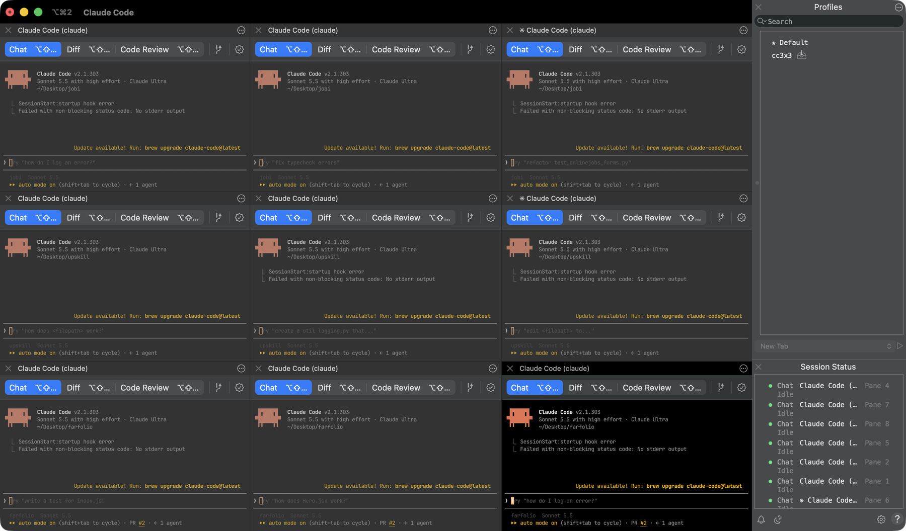

# cc3x3 for iTerm2

One command splits an iTerm2 window into a 3x3 grid of Claude Code sessions, one row of three per project folder.
The iTerm toolbelt lists every session and whether it is working or idle.



```sh
cc 3x3 api web docs      # 9 sessions: a row of 3 in each folder
cc 3x3 api web           # 6 sessions
cc 3x3 api               # 3 sessions in one folder
cc 3x3                   # no names: pick 1 to 3 folders in a fuzzy list
```

macOS and iTerm2 only. Terminal.app cannot split panes from a script, so it is not supported.

## Set it up with Claude Code

Open Claude Code in any folder and paste this. It installs everything and tells you the one setting it cannot click for you.

```text
Set up cc3x3-iterm on this Mac so that typing `cc 3x3 <folder> <folder> <folder>` in iTerm2 opens a 3x3 grid of Claude Code sessions.

1. Check this is macOS and that /Applications/iTerm.app exists. If iTerm2 is missing, tell me to run `brew install --cask iterm2`, then stop.
2. Clone https://github.com/JivSTuban/cc3x3-iterm into ~/cc3x3-iterm. If the folder already exists, run `git pull` in it instead.
3. Run `sh ~/cc3x3-iterm/install.sh`. It creates a Python venv (3.10 or newer), installs fzf, and adds one `source` line to ~/.zshrc.
4. Run `defaults read com.googlecode.iterm2 EnableAPIServer`. If it does not print 1, tell me to open iTerm2 > Settings > General > Magic, tick "Enable Python API", and restart iTerm2.
5. Run `~/cc3x3-iterm/.venv/bin/python -m unittest discover -s ~/cc3x3-iterm/tests` and show me the result.
6. Tell me to open a NEW iTerm2 window and run `cc 3x3 <one of my project folders>`. Do not run it from this session.

Show each command before you run it. Stop at the first error and show me the exact output. Do not change anything except ~/cc3x3-iterm and the one line in ~/.zshrc.
```

## Use it

```
cc 3x3 api web docs         # folder names under CC_ROOTS, or paths
cc z-2 3x3 api web docs     # same, with the font two steps smaller
cc z-2 | cc z0 | cc z2      # alone: zoom every pane in this tab (base size is 10 on a laptop, 12 on a desktop)
cc 3x3 api -- --model opus  # everything from the first -flag goes to Claude
cc 3x2 api web | cc 2x2 ... # tiled windows instead of panes: 3 columns x 2 rows, or the four screen corners
cc                          # tile THIS window; Claude starts here if it is a project, else you pick one
ccgrid [layout]             # re-tile every iTerm window without launching anything
```

- `cc 3x3` takes 1 to 3 folders. A fourth is refused before anything opens.
- The pane you typed in runs the first session itself, so quitting Claude leaves a prompt there.
- If the tab already has splits, the grid opens in a new tab.
- Panes are equal in size and copy this window's profile, so a zoom carries over.
- The toolbelt (Profiles and Session Status) is switched on if it is off. It is never switched off.
- Three sessions in one folder share one working tree. Give them different tasks, or use git worktrees.

The picker lists every folder with `.git` or `CLAUDE.md` under `CC_ROOTS` (3 levels deep), newest git activity first.

## Manual setup

```sh
git clone https://github.com/JivSTuban/cc3x3-iterm ~/cc3x3-iterm && sh ~/cc3x3-iterm/install.sh
```

Needs iTerm2 3.x with **Settings > General > Magic > Enable Python API** on, Python 3.10+ (the installer finds or installs
one), `fzf` (the installer runs `brew install fzf`), and `claude` on `PATH`.
The installer makes a venv with the `iterm2` package and adds one `source` line to `~/.zshrc`.
Open a new iTerm2 window and type `cc 3x3 <folder>`.

`cc` shadows `/usr/bin/cc` (the C compiler) in interactive shells only. `make` and scripts are unaffected;
reach the compiler with `command cc`.

## Config

Set in `~/.zshrc` before the `source` line.

| Variable | Default | What it does |
| --- | --- | --- |
| `CC_TOOLBELT` | `1` | `cc 3x3` shows the iTerm toolbelt (Profiles, Session Status) if it is hidden, so you see each Claude pane's state. `0` leaves it alone. |
| `CC_ROOTS` | `(~/Desktop)` | Folders searched for projects. A zsh array: `CC_ROOTS=(~/Desktop ~/work)`. |
| `CC_LAUNCH` | `claude` | Command each pane runs. Use `claude --dangerously-skip-permissions` for unattended agents. |
| `CC_WIDTH3` | `0.92` | Fraction of the screen the tiled-window layouts (`cc 3x2`) span; the rest is side strips for a browser. 2x2 always uses the full width. |
| `CC_FONT_LAPTOP` / `CC_FONT_DESKTOP` | `10` / `12` | Base font size per machine. A Mac with a battery counts as a laptop. |

Zoom writes an iTerm dynamic profile named `cc3x3` (your Default profile with only the font size changed). Your own
profiles are never edited.

## Behavior to know

- A full-screen window is taken out of full screen before `cc 3x2` or `cc 2x2` tile it (it waits for the Space animation to finish).
- Windows in full screen, minimized, or on another Space are not counted and never moved by the tiled layouts.
- `cc 2x2` with more than four windows (or `cc 3x2` with more than six) moves nothing and says how many to close.
- If `cc` prints `cannot reach iTerm2`, enable the Python API (Setup above) and restart iTerm2.

## How it differs from the Windows version

Port of [riecodes/cc3x3](https://github.com/riecodes/cc3x3) (Windows Terminal + PowerShell) to macOS and iTerm2.

| | Windows | iTerm2 |
| --- | --- | --- |
| Grid | Moves terminal windows into cells | `cc 3x3` splits panes in one window; `cc 3x2` and `cc 2x2` still tile windows |
| Moving windows | C# `SetWindowPos` compiled on first use | iTerm2 Python API `Window.async_set_frame` |
| Screen area | Win32 monitor work area | `NSScreen.visibleFrame` (menu bar and Dock excluded), per screen |
| 2x2 | Drives the Snap Layouts menu over UI Automation (3 s, steals focus) | Plain moves, same as 3x2 |
| Zoom | Edits Terminal `settings.json` | Writes the `cc3x3` dynamic profile and switches every pane in the tab to it |
| Multi monitor | One monitor only | Each window is tiled on the screen it sits on |

AppleScript is not used: iTerm2 marks it deprecated. Panes, fonts and the toolbelt go through iTerm's Python API; one
`osascript` call reads screen geometry for the tiled layouts.

## Files

- `grid.py`: grid math, pane plan and even sizes, no iTerm dependency (`python -m unittest discover -s tests`).
- `cc3x3.py`: splits panes (`panes`), moves windows, writes the zoom profile.
- `cc.zsh`: the `cc`, `ccgrid`, `cczoom` functions.
- `install.sh`: venv and `~/.zshrc` line.

MIT, same as the original.
